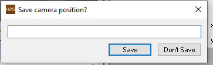
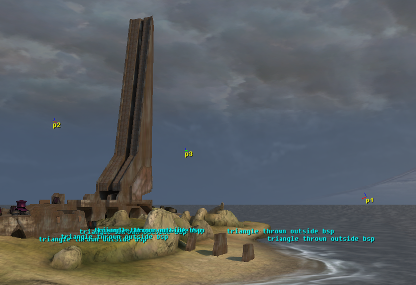
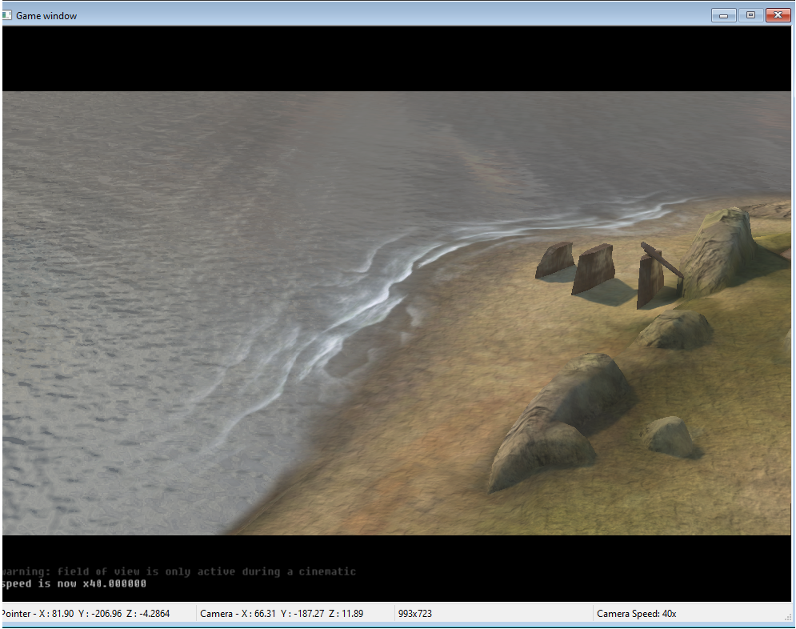

The very basics of what makes a cutscene in (most) Halo games, consists of:

* A camera that portrays what the player will see during the cutscene
* The actors, playing out animations at specific times
* Effects that trigger at the right time
* Lighting, objects and other entities to portray emotion and scenic environments

To do this, a combination of scripts and entities are required.

# Creating a basic cutscene

The order of sequences for a cutscene start with:

* Player triggers the cutscene
* A transition is played
* Player control is taken away and view is put to camera

When a cutscene ends, the opposite of these happens.

Start by setting up your Sapien and scripts with the following:

* A scenario of your choice
* Any biped of your choice
* A correctly set up data folder and scripts for your scenario.

Setup your actors such so they are ready to perform when the camera starts rolling.

# Camera control
In Sapien, *Camera points* are the entities a camera will point *from* towards your scene. Position your in-game view accordingly, and hit Space. This prompts a dialog for camera creation. Give it a name and hit save.





Create a few points so your camera has places to go. Based on your points names, to give control to the camera and pan across your points, use the following script:

```hsc
(script static void intro
	(camera_control true)
	(camera_set p1 0)
	(camera_set p2 100)
  (sleep 100)
	(camera_set p3 100)
  (sleep 100)
	(camera_control false)
)
```
Please note: The camera movement happens over a number of ticks; however the execution is not blocking and your script will continue to run. To give the camera some time to animate, create `sleep` calls after each `camera_set` call.

This is the simplest form of camera control. Test it out by running `intro` in Sapien while being in Player Simulation mode, or run it in tag test.

At the end of the animation, you'll notice that as soon as camera control is given back to the biped, your FP view comes in and badly transition. This is where scene effects come into play.

# Scene effects

To ensure a more visually pleasing cutscene takes place, Halo 2 has a wide array of effects that can help set the tone.



For starters, expand the script with the following:

`(fade_out 1 1 1 0)`: Sets the screen to white as soon as the script runs (The final short value is the amount of ticks for fade duration)Runs a black fade effect from 0% to 100% black screen. 
`(set cinematic_letterbox_style 1)`: Introduces letterboxing on your screen. Note: Aspect ratio dependent and might not be visible on your screen in Sapien.
`	(camera_set_field_of_view 60 0)`: If preferred, the FOV of the camera can be set.
`(fade_in 1 1 1 60)`: Slowly fades from white to image

```hsc
(script static void intro
<!--  Start with a white screen -->
	(fade_out 1 1 1 0) 

<!-- Enable the letterbox during the fade -->
	(cinematic_show_letterbox 1)

<!-- Optional -->
	(camera_set_field_of_view 60 0)

<!-- Give control to the engine for camera animation -->
	(camera_control true)

<!-- Fade in and wait until fully faded in -->
	(fade_in 1 1 1 60)
	(sleep 60)

<!-- Camera tracks -->
	(camera_set p1 0)
	(camera_set p2 100)
	(sleep 100)
	(camera_set p3 100)
	(sleep 200)

<!-- End on p3 and fade into gameplay -->
	(fade_out 1 1 1 60)
	(sleep 100)
	(camera_control false)
	(cinematic_show_letterbox 0)
)


```





There is an abundance of effects you can use:

* Bloom
* Depth of field
* Cross fades
* Screen shake effects

Some of the use the prefix `cinematic_screen_`, others might be player specific effects:

```hsc
	(player_effect_set_max_rotation 0 1 1)
	(player_effect_start .5 3)
```

This shakes the player's screen, simulating a tremor or earthquake-like effect.