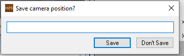
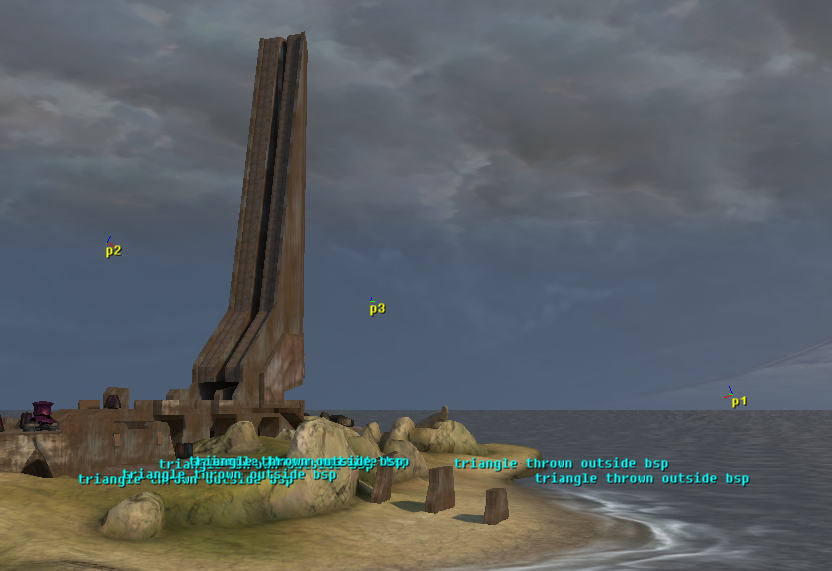
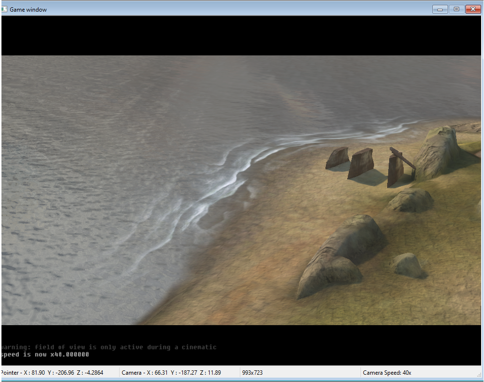
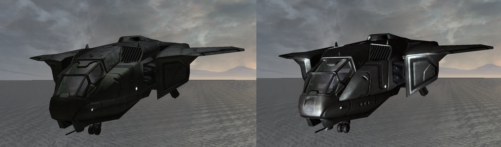
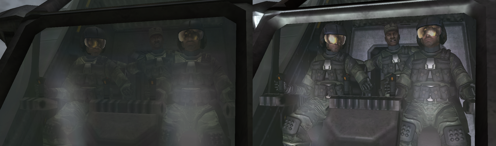
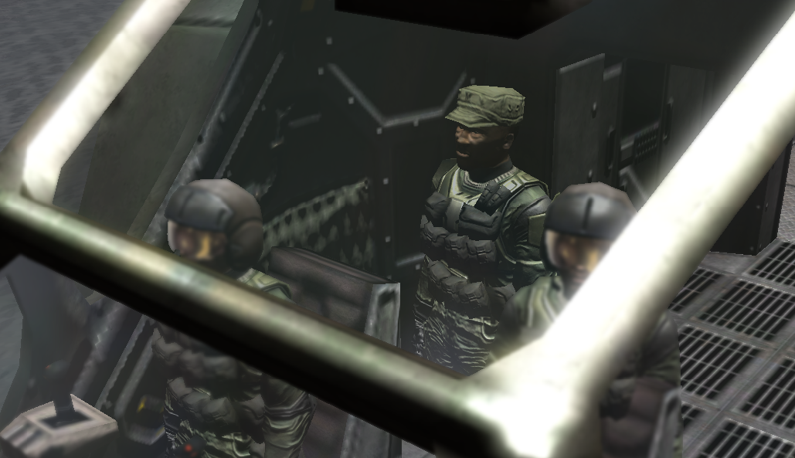
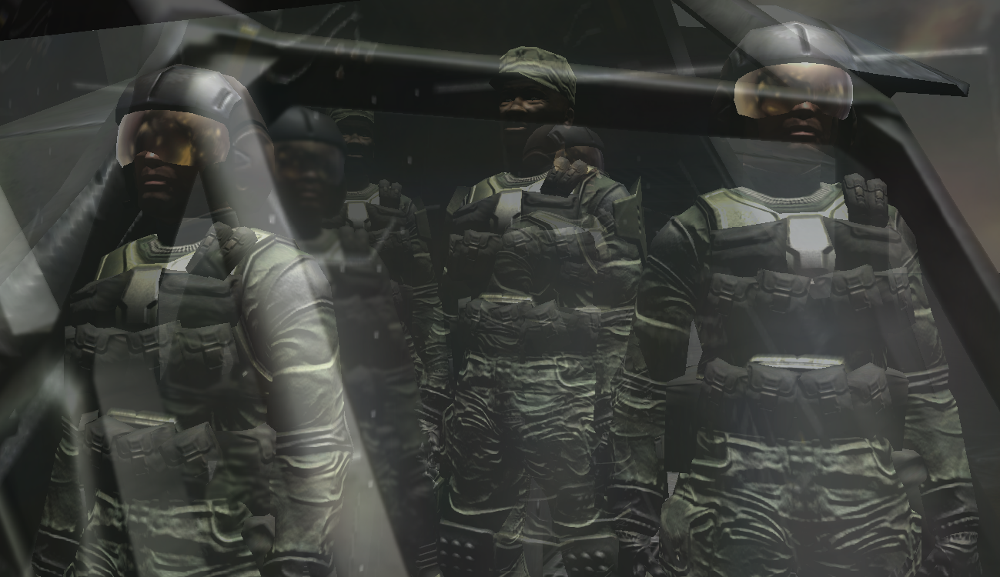

The very basics of what makes a cutscene in (most) Halo games, consists of:

* A camera that 'views' what the player will see during the cutscene
* The actors, playing out animations at specific times
* Effects that trigger at the right time
* Lighting, objects and any other entities that portray emotion or scenic environments

To do this, a combination of scripts and entities are required.

# The basics

The simplest of cutscenes can be executed with these actions:

* Player triggers the cutscene
* A transition is played (Such as a fade to white or fade to black)
* Player control is taken away and view is put to camera
* Actors are spawned and moved 

When a cutscene ends, the opposite of these happens.

Start by opening Sapien and preparing with the following:

* A scenario of your choice
* Any biped of your choice
* A correctly set up data folder and scripts for your scenario.

Set your actors such so they are ready to perform when the camera starts rolling; Place them in the correct position, ready an animation or prepare a command script for the actors to execute. The contents of a cutscene will not be covered in this guide.

# Camera control
In Sapien, *Camera points* are the entities a camera will point *from* towards your scene. Position your in-game view accordingly, and hit Space. This prompts a dialog for camera creation. Give it a name and hit save.



 

Create a few points so your camera has places to go. Based on your points names, to give control to the camera and pan across your points, use the following script:

```hsc
(script static void intro
	(camera_control true)
	(camera_set p1 0)
	(camera_set p2 100)
	(sleep (camera_time))
	(camera_set p3 100)
	(sleep (camera_time))
	(camera_control false)
)
```
Please note: The camera movement happens over a number of ticks; however the execution is not blocking and your script will continue to run. To give the camera some time to animate, create `sleep` calls after each `camera_set` call.
The command `(camera_time)` gives you exactly the amount of ticks still required for a camera animation, which allows for slightly more robustness in your code.

This is the simplest form of camera control. Test it out by running `intro` in Sapien's console. Note that you will have to be in Player Simulation mode, or else the camera control can not be taken away from the player and the Sapien camera will take precedence. To go in Player Simulation mode, open the "Player Simulation"  folder in Sapien's Hierarchy View

At the end of the animation, you'll notice that as soon as camera control is given back to the biped, your FP view comes in and badly transition. This is where scene effects come into play.

# Scene effects

To ensure a more visually pleasing cutscene takes place, Halo 2 has a wide array of effects that can help set the tone.
For starters, expand the script with the following:

`(fade_out 1 1 1 0)`: Sets the screen to white as soon as the script runs (The final short value is the amount of ticks for fade duration)Runs a black fade effect from 0% to 100% black screen. 
`(set cinematic_letterbox_style 1)`: Introduces letterboxing on your screen. Note: Aspect ratio dependent and might not be visible on your screen in Sapien.
`(camera_set_field_of_view 60 0)`: If preferred, the FOV of the camera can be set.
`(fade_in 1 1 1 60)`: Slowly fades from white to image
`(sleep (camera_time))` This sleeps for the duration the camera still needs for interpolating between two points.

```hsc
(script static void intro
<!--  Start with a white screen -->
	(fade_out 1 1 1 0) 

<!-- Enable the letterbox during the fade -->
	(cinematic_show_letterbox 1)

<!-- Optional -->
	(camera_set_field_of_view 60 0)

<!-- Give control to the engine for camera animation -->
	(camera_control true)

<!-- Fade in and wait until fully faded in -->
	(fade_in 1 1 1 60)
	(sleep 60)

<!-- Camera tracks -->
	(camera_set p1 0)
	(camera_set p2 100)
	(sleep (camera_time))
	(camera_set p3 100)
	(sleep (camera_time))

<!-- End on p3 and fade into gameplay -->
	(fade_out 1 1 1 60)
	(sleep 100)
	(camera_control false)
	(cinematic_show_letterbox 0)
)


```





There is an abundance of effects you can use:

## Cinematic lighting

Cinematic lights are "invisible" lights that ooze atmosphere over your scene. It can be set with direction (pitch + yaw) and rgb values. Be sure to enable objects to use the cinematic lighting.

```hsc
(cinematic_lighting_set_primary_light -23 152 0.576471 0.513726 0.4)
(cinematic_lighting_set_secondary_light 38 222 0.141176 0.141176 0.290196)
(cinematic_lighting_set_ambient_light 0 0 0)
(object_uses_cinematic_lighting pelican 1)
```




## Bloom

Bloom effects can be written/overridden to increase the effect. By default, it is already slightly applied.

```hsc
(cinematic_start)
(rasterizer_bloom_override 1)
(rasterizer_bloom_override_threshold .6)
(rasterizer_bloom_override_brightness .5)
```


## Depth of field

Depth of Field introduces a bokeh blur effect on your camera. The game needs to be set to "cinematic" with `cinematic_start`, which allows you to set more screen effects.

```hsc
(cinematic_start)
(cinematic_screen_effect_start 1)
(cinematic_screen_effect_set_depth_of_field 1.5 1 1 0 0 0 0)
```



## Cross fades

A crossfade initiates a start of the fade effect for the set duration. During this time, you need to set another camera point for it to transition to. Think of it like this: The crossfade command iniates a ghost images that will disappear over *n* seconds.

```hsc
(cinematic_screen_effect_set_crossfade 1)
(camera_set p2 0)
```



## Screen shake effects

Some effects are cinematic, meaning they apply to the camera, others might be player specific effects, such as a screen shake.

This shakes the player's screen, simulating a tremor or earthquake-like effect. It can also be used while in gameplay or in first-person view. Play around with options.

```hsc
(player_effect_set_max_rotation 0 1 1)
(player_effect_start .5 3)
```


## Other effects

There are a variety of scripts that can be used for cinematics; have a look at the table below. There might be other effects that have not been properly documented yet, so this list is not comprehensive yet.

