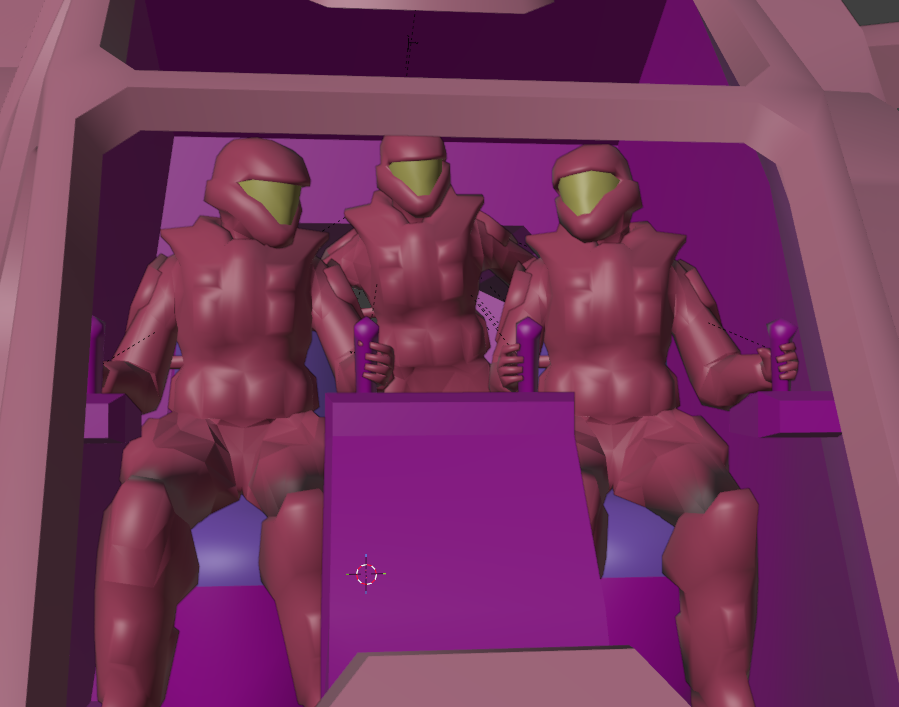
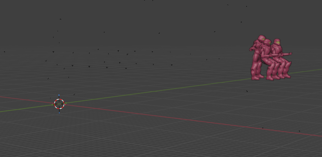
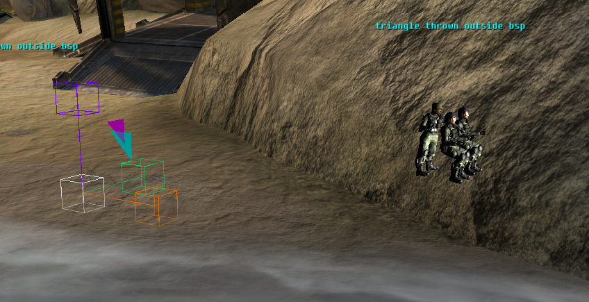

During a cutscene, you can either play out regular biped controlled actions (Walking, shooting, jumping) or create a custom keyframed animation and have that play out. Cinematic animations are slightly different, in that they require more control and setup. A biped exists in the game world, and has a specific position in the game world. Custom animations, depending on the type of animation, play out on a location, in sync with other animations, parented to objects, etc. A lot of trickery can be involved in getting everything right, and the tricks will be explained on this page.

# Exporting custom animations

This guide will not go in detail how to animate; it's a valuable skill that you can teach yourself. After having created an animation, you have a variety of options of exporting it. (See https://c20.reclaimers.net/general/source-data/animation-data/ )

In the case of cinemation animations, you will need JMA. Export the file, and create an animation_graph tag that contains the specific animations for your bipeds. In this example, we have three Marine (ODST + Johnson) animations that will play out in sync.
  

In this case, we have three JMA files; One for each character. Since they both make use of the same armature, they can be compiled into a single animation_graph.

* Ensure your keyframes are baked
* Ensure transformations have been applied

# In game
In the H2 engine, objects are parented towards an *anchor*. There's a `cinematic_anchor` tag that's specific to this case (It's nothing more than an empty object without a render_model).

Create the necessary bipeds and the anchor.

Depending on how you created the animation, the relative position of the anchor vs your bipeds should be the world origin of your bipeds in Blender. See below comparison for more clarification.




To get the perfect picture, it requires some playing around what works in your animation in relation to your anchor.

Next, use the following script to anchor the bipeds, and play the cinematic_animation.

The docs explain this one already, but some more additional info:

`(custom_animation_relative <biped name> <relative path to animation_graph> <string of animation> <boolean to interpolate animation y/n> <anchor name>)`

In short, below script plays the animation.

```hsc
(object_create_anew johnson)
(object_create_anew pilot1)
(object_create_anew pilot2)
(object_create_anew pelican)
(custom_animation_relative johnson cutscenes\b31\b31 "b31_intro_1_johnson" false anchor)
(custom_animation_relative pilot1 cutscenes\b31\b31 "b31_intro_1_pilot1" false anchor)
(custom_animation_relative pilot2 cutscenes\b31\b31 "b31_intro_1_pilot2" false anchor)
```

If you want to play the scene outside of a cutscene, and on the location of the biped, you will require a JMM file and the command `custom_animation`.


