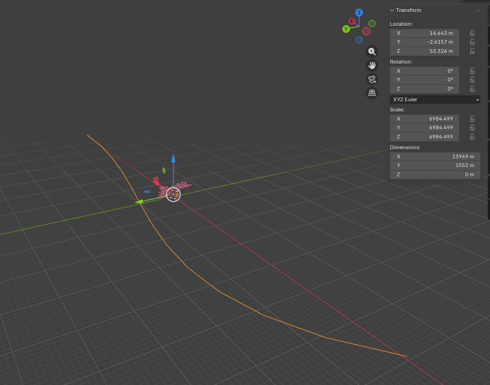
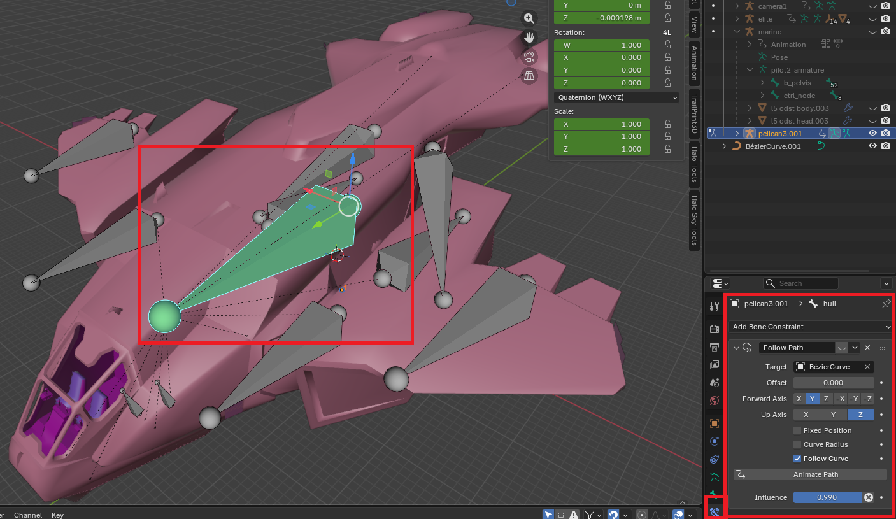
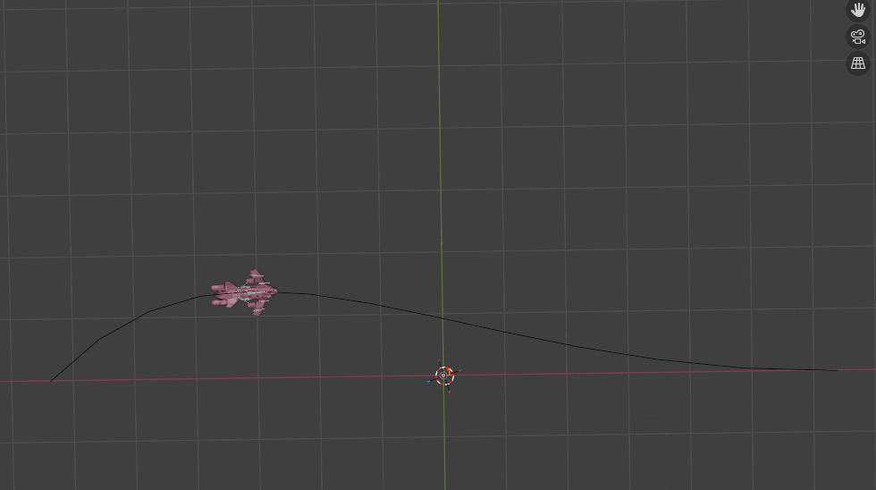
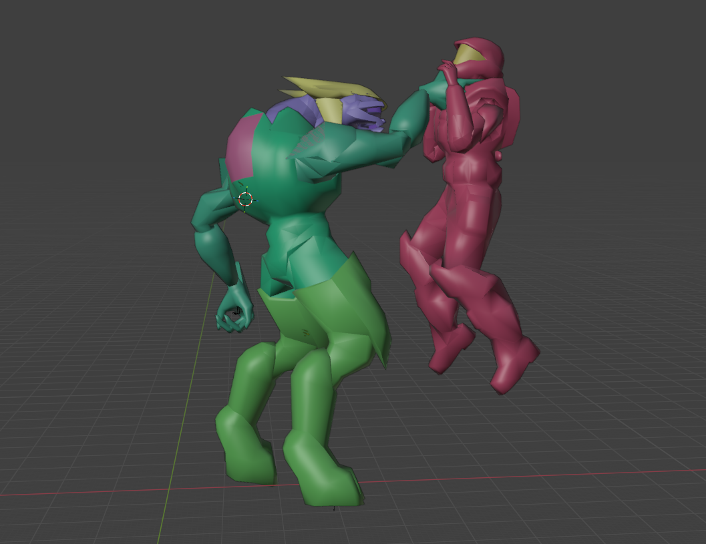
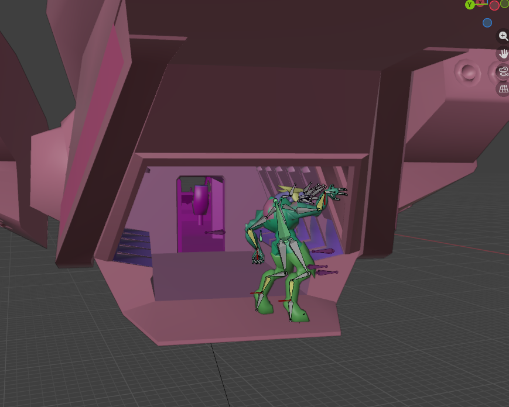
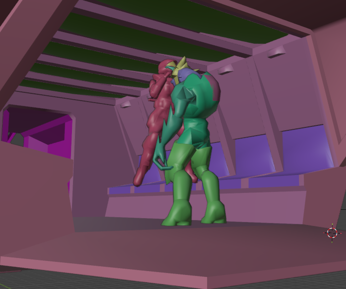
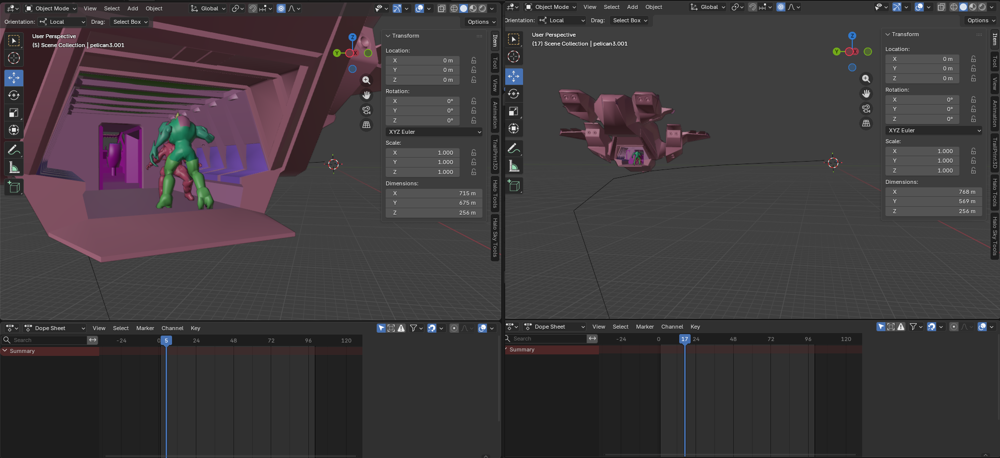
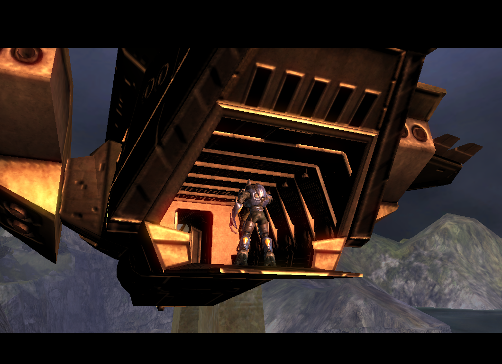
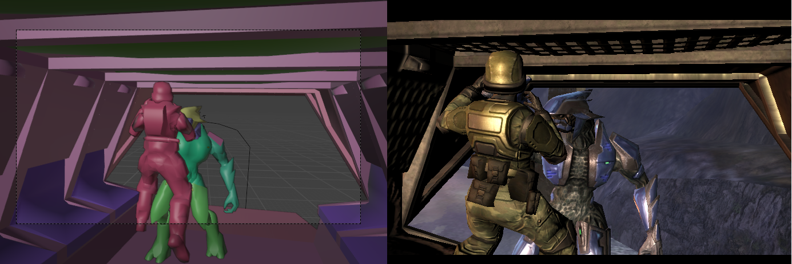

# Blender

This guide delves into deeper detail to get your animation from Blender into Halo 2. Creating an IK rig or creating specific keyframe animations is not part of this guide.

To properly understand motion in Halo 2's animations, we will take an example of a Pelican taking flight.
Usually, a Pelican flight path is determined by it's physics and an AI character controlling the motion and path finding.

For cutscenes however, if we play by rules of H2 retail, everything is a keyframed animation that plays out exactly how it was animated, even the camera.

If we have Master Chief standing in the troop bay of a Pelican while the camera points at his face, he is not seated in the vehicle. The Pelican as well as Master Chief both have independent animations that move them forward, and by playing them in sync gives the impression of being a passenger in the vehicle.

# Simple motion

Import a vehicle into Blender.

Create a Bezier Curve by clicking Add > Curve > Bezier Curve. Scale it up so it is visible to the naked eye. After scaling / changing the path, make sure you Apply Transformation (F3 > Apply Transformation). This ensures that all changes you make to any mesh, get applied and 'reset' as the new baseline.

The path of the curve will be the Pelican's flight path.



Next, enter Pose Mode and select the top-level bone of the vehicle's armature. Click Add Bone Constraint > Follow Path. Select the Bezier Curve in the Target, and change any settings to achieve the desired effect.




Click "Animate Path". If everything was properly done, you'll notice the vehicle instantly snapping to the curve and following it. If you desire a different length of the animation, you can edit the animation data in the *Curve's* settings (And not the constraint).



# Actor positioning
Now, moving a vehicle is simple as it doesn't need that much animation when it's moving from point A to point B. Having your actors pose or play out an animation *while* in a vehicle is a different story.

If your animation is going to convey a lot of motion, it's important you have a way to move your armature in Pose Mode without impacting any actual poses. For instance, if your actor is going to ride along in a vehicle. Usually, a physics_control or parent bone takes care of this, as all other bones are parented to this root bone.


The control node of the armature allows you to move it around full without actually posing.


First, set up the scene by importing each of the required actors. Ensure both are on 0,0,0 world position, as this is the position the anchor in-game will take the place of.

.")

Enter Pose Mode and create an animation from this starting point. If you move your armature in Pose Mode and keep your origin anchored, the in-game anchor will understand the relative position of this animation. Create your animation.



# Advanced motion

Now that you have a basic vehicle path, as well as the ability to keyframe and move your actors around, let's add them together so we can make dynamic animations.

Since we have a physics control bone that can move our actors freely around, these can be used for the same constraints we used for the vehicle.

Note that if you temporarily want to disable motion, click the eye symbol on any of the constraints. This makes it slightly easier to play around with specific animations on the timeline without losing track of the vehicle.

Select all required actors' root bone and create another constraint. This time, Bone Constraint > Child Of. From here, select the vehicle's root bone.


Select the vehicle's root bone so both root bones will be connected to each other


You'll notice the actor will snap to the vehicle. You can hit Set / Clear Inverse to add an optional correction to the position data (If your animation needs to become part of the relative position of the vehicle). From here on, you can use the root bone to re-position your actor correctly.





If you have been using your root bone for movement data, add another single-bone armature in between. The hierarchy should look like:
pelican:root_bone > container_armature > elite:root_bone. Your container armature should not be used for animation, but merely for positioning. In general, position should *always* be done in Pose Mode. Halo will only take positional data from keyframes in animations. The same goes for the container armature.


After all the needed corrections / and offsets, your actors should be inside the vehicle.



If every Constraint is currently enabled, you should see your animation played out while the vehicle is moving forward.



Export each actor's animation separately as JMM, and import them into a model_animation_graph with Tool. Make sure you import your animation *Uncompressed*. Compression will make the motion in-game jitter around.

After getting the tags created, run each of the animations in script with the following commands:

```hsc 
(custom_animation_relative elite cutscenes\anims "elite" false anchor)
(custom_animation_relative marine cutscenes\anims "marine" false anchor)
(custom_animation_relative pelican cutscenes\anims "pelican" false anchor)
```



# Camera tracks

While you can get away with camera points placed in Sapien, following moving objects is difficult with this method. As such, camera tracks are also created with keyframed animations.

In Halo, the camera also has an armature, one with just a single bone. To have it follow a path, or a vehicle, we follow the same principles as a vehicle or actor. (See above)


You might require some troubleshooting to mimick the angle / rotation that the camera armature uses in-game



After creating a path or keyframed animation for your camera, follow the same actions and export as JMM. 

In Sapien, a camera anchor is different from the animation anchor. They can be placed under Game Data > Flags.




If everything has been created properly, expand on the script with the following. (Don't forget that camera control can only be taken from a player, and not from Sapien's camera. To see the animation in Sapien, enter Player Simulation mode first.)

The end result should look like this:


```hsc 
<!-- New -->
(camera_control 1)
(camera_set_animation_relative cutscenes\camera "camera" none cam_anchor)

(custom_animation_relative elite cutscenes\anims "elite" false anchor)
(custom_animation_relative marine cutscenes\anims "marine" false anchor)
(custom_animation_relative pelican cutscenes\anims "pelican" false anchor)
```