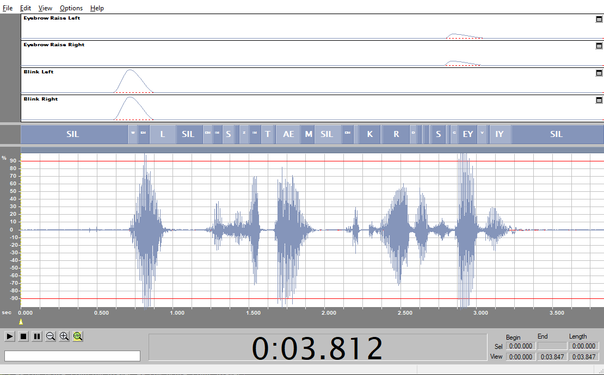

Dialog and music elevate your cutscene to the highest level. Dialog (and lip-syncing) is embedded in the engine and auto-plays if your .sound tag contains the necessary animation info.

# Dialog

Dialog is played on a specific biped. Lip-syncing happens via phoneme animations and is applicable for most bipeds with a mouth.

Play a piece of dialog with the following script; the last three parameters are the biped, audio scale and a DSP effect that can be applied over the audio.


```hsc
(sound_impulse_start_effect sound\dialog\levels\03_earthcity\cinematic\c03_1030_jon johnson 1 radio_default_loop)
```

* `radio_default_in`: Plays a radio effect, starting with a click-on sound.
* `radio_default_loop`: Plays a radio effect
* `radio_default_out`: Plays a radio effect, ending with a click-off sound.

The following are similar to the above effect, but used for Covenant radio.

* `radio_covy_in`
* `radio_covy_loop`
* `radio_covy_out`

## Custom dialog with lip sync

Importing new sounds and playing them in-game is not enough to get lip syncing actors working.

To create a sound tag that includes lip sync data, use the software "Impersonator Studio". This software generates an LTF file that, together with your .wav file, can generate a sound tag that includes the lip sync data.

Note: In-game, the DSP effects can only be applied to mono audio! Stereo audio files will crash when a DSP effect is applied. It's recommended to have all dialog audio be mono files.

Start by creating your own dialog in a tool of your choice or download a piece of audio from somewhere. Next, open up a text editor and create a .txt file that contains the transcription of the audio.

It's recommended to create a clean folder; Put your wav file and text file in this new folder.

Open up Impersonator and hit File > New Session. It will prompt you to select the wav and text file. From there on, you have the choice to alter the phonemes that have been recognized by Impersonator or leave it as is.

Save the LTF file by hitting File > Save LTF. Include this file together with your wav file in the desired data folder (The regular data folder required for importing via H2 Tool) and import the sound as a cinematic_dialog and  one_shot variables.

`tool sounds-one-shot <folder> cinematic_dialog opus`

Finally, play your audio file with the scripts mentioned above.





# Music

Music is constructed in phases, with an intro, middle and outro part. The intro plays once, the middle keeps looping until it's scripted the music is allowed to end.

It can simply be started with the command `sound_looping_start`. Use a tag editor to find existing music from the retail game to play in your scenes, or import your own via Tool.
```hsc
(sound_looping_start "scenarios\solo\03a_oldmombasa\03a_music\03a_065" none 1)
```