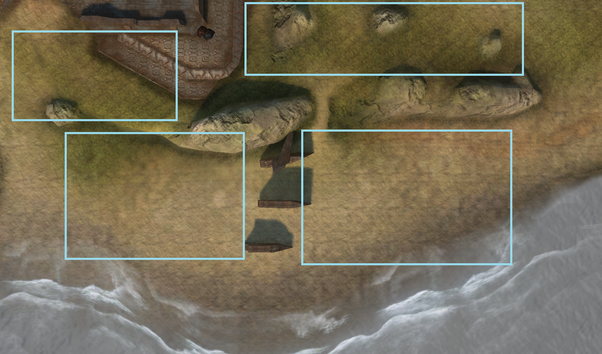
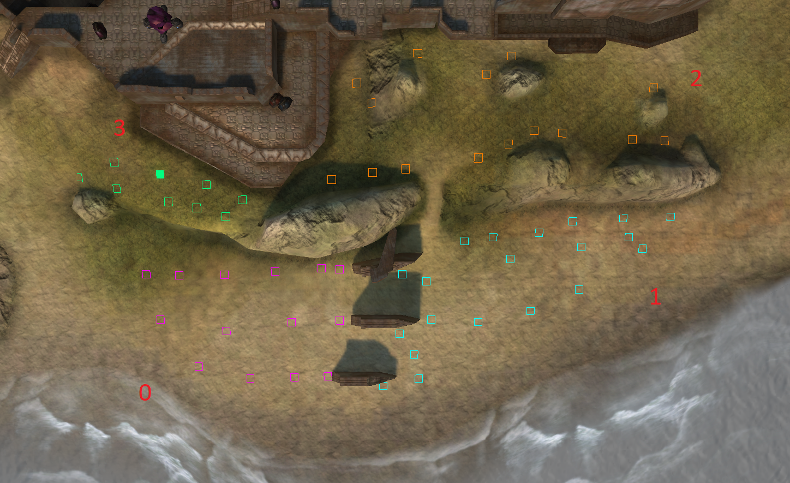
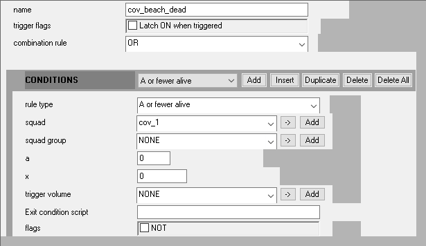
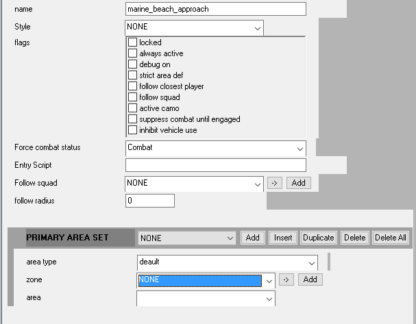
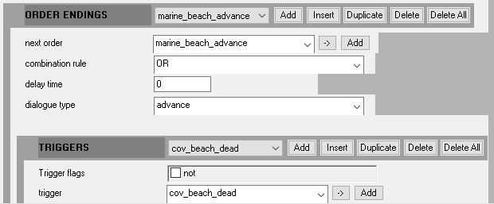
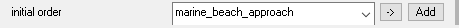
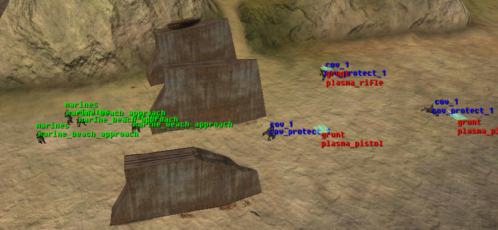
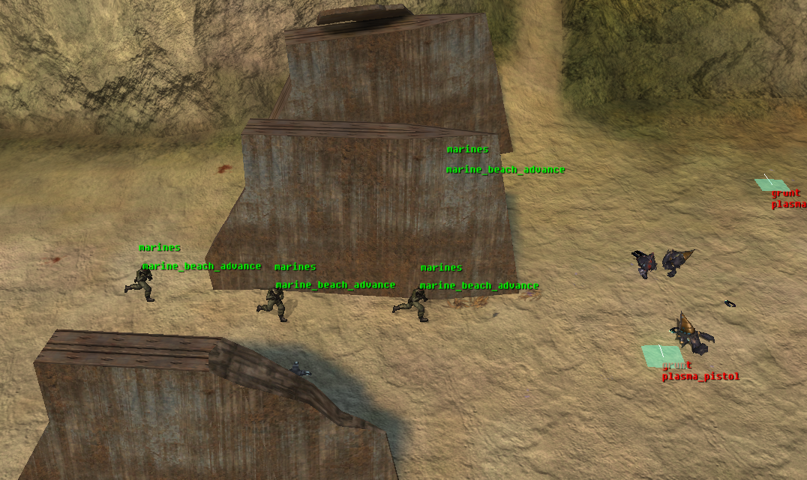
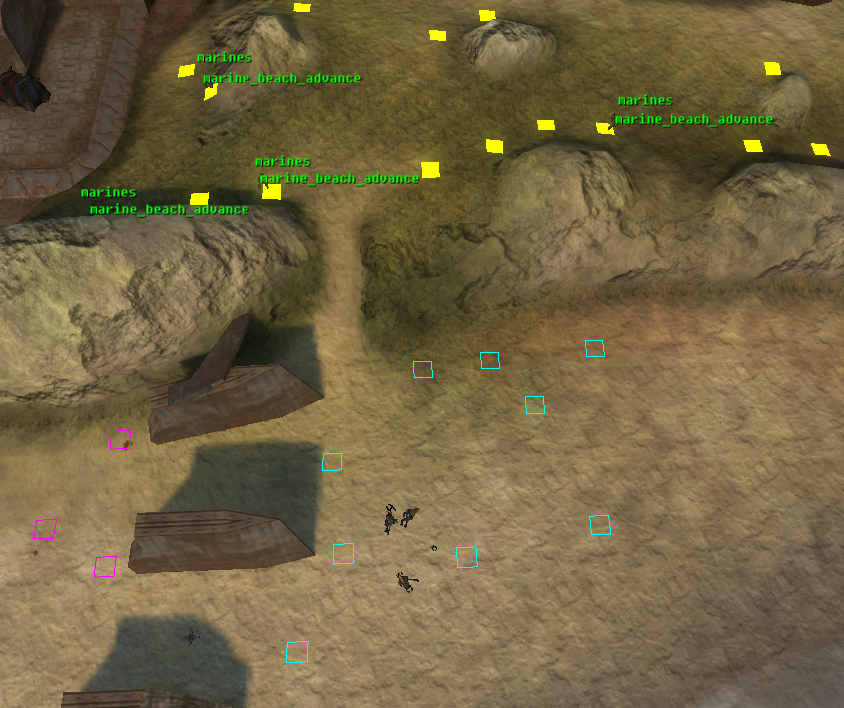
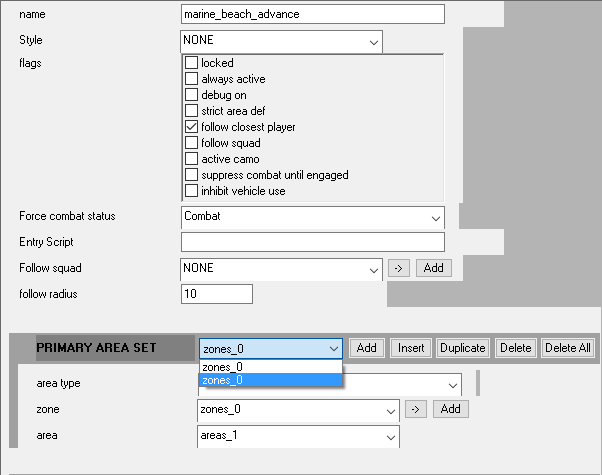

Besides simply placing AI and have them fight in your missions, there's a plethora of options to make combat and encounters feel realistic. There's a few methods of interest that will be covered on this page.

# Zones / Areas

Commonly, encounters are fought out in Zones, which in turn have Areas. The basic guide covers the majority of how to make use of Zones and Areas. Let's create a properly structured cluster of areas inside a zone.

One zone per encounter is sufficient for most missions. Each area should only encompass about 10-20 firing positions near and around specific objects within an area.

Both humand and covenant during an encounter can make use of the same zone and area. The split will happen in the form of Orders.

# Orders

Orders are a sequential play of phases in an encounter. They will allow AI to know what to do within an Area, and when to move on to the next.

## Triggers

Triggers can be created for sequencing Orders based on specific conditions. 

## Creating a sequence of orders

Let's create a simple example: We will have Marines approach the beach landing and have them move to the next area only when the covenant in a section have been eliminated.

The structure will be as follows:

* The zones are created in segments that make sense for this beach approach.
* Each phase of the order structure will be a separate order entity.
* Orders can be chained together via triggers and order sequencing.

Create two orders for the marines, one order for the covenant.

* marines_beach_approach
* marines_beach_advance

Set up these two orders to encompass the needed Areas. (The advance order needs a different area)

After the sequence of two is created, set the initial order to the squad:

Place both squads and let them play out.

After eliminating the enemy, the order changes to the next to advance and the marines advance into the next area.

Live editing the order also changes the actual order, and the marines move to different areas while you change it.

# Follow
Outside of any encounter, you want marines to advance together with you from zone to zone.

There's following across zones, and following within zones.

## Across zones
Often, a zone is related to an encounter and related to specific squads. If marines survive an encounter, and you want them to accompany in future Zones and Orders, you will need to migrate existing actors to future squads.
Because it's difficult to set up all existing AI squads with all possible zones and orders, the correct way is to migrate existing actors.

`ai_migrate <old squad> <new squad>` moves all actors from one to the other squad. 

## Inside zones

AI can switch areas inside a zone by having multiple *Primary Area Sets* that they switch between based on their follow strategy.
In any active order, set up multiple area sets by clicking Add and selecting the correct area and zone. Set up the follow radius to something between 5 - 10 world units. Be sure to tick "Follow closest player" as well.

# Pathfinding Hints
Pathfinding hints can be placed in the world to let AI know what is the best way to navigate between places if the BSP doesn't clearly tell the AI.


The different types of pathfinding hints 


