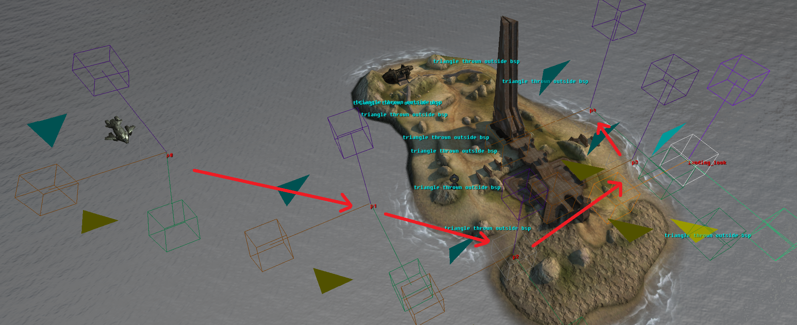
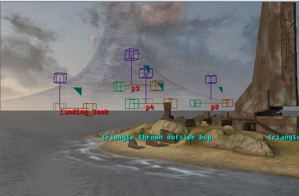
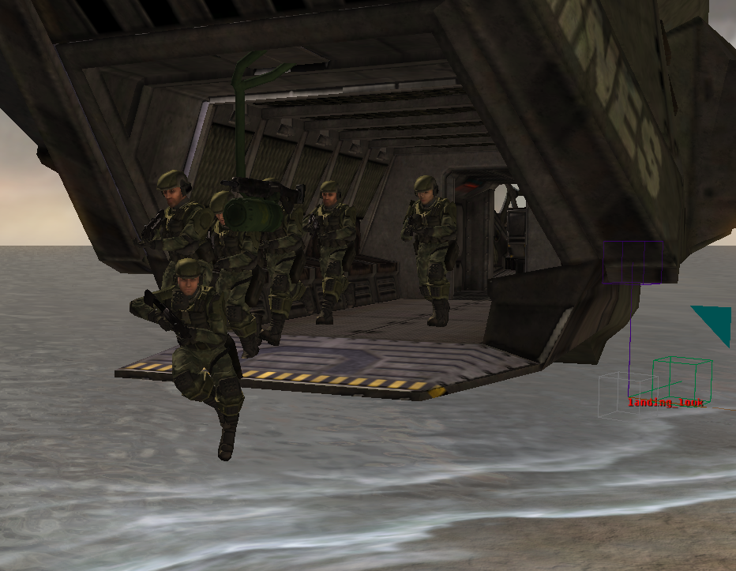
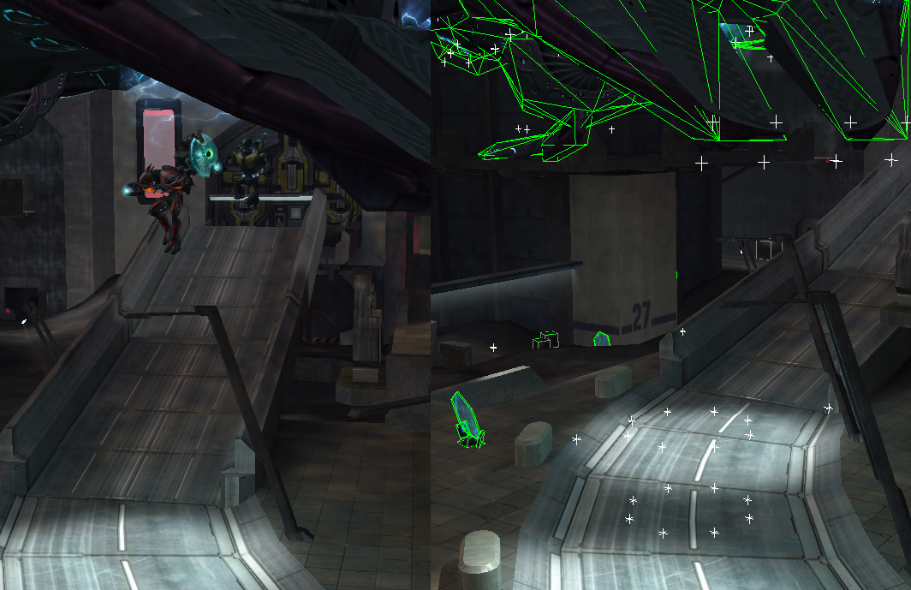

A common way to dynamically place AI assets in your map is via a dropship; be it a Pelican or  a Phantom. This guide delves into the basic steps to have a Pelican/Phantom navigate to a spot, drop off a squad, and fly away again.

In Halo 2, vehicles are generally actually piloted by AI as opposed to Halo 1, where recordings of controller input are being replayed.

Note: This guide will explain the steps with a Pelican. The steps for a Phantom are the same, with small alterations that will be mentioned. It is recommended to have read through [Basic AI Encounters](~basic_encounter).

# Setting up the Pelican

Open your scenario and by adding *pelican.vehicle* to your tag palette.

Create two separate squads: One that will control the vehicle, the other a squad of Marines that will leave the Pelican. We will call them `pilot` and `passengers`.
Note: You can also have one squad with separate actors, both as pilot and passengers. However, keeping them separate gives slightly more control and structure to your AI setup.

For the pilot squad, put the `vehicle` field to `pelican` and `character` to `marine` and the squad size to 1. Put the spawn position somewhere off the main map (But within the BSP mesh). 
For the passenger squad, put `character` to `marine` and set squad size to any preferred size. Put the spawn position somewhere off the main map as well(But within the BSP mesh). These marines will be placed inside the Pelican via HaloScript.


If set up correctly, placing this squad will create a flying Pelican.


# Creating a flight path

Dropships fly via Scripted Point Sets.

Create a new Point Set, and place the points in Sapien with right-click. Create a path you want the Pelican to follow. Keep the points sufficiently close to each other, as they need to stay within pathfinding distance.



The point set naming




You can optionally place a "direction point". This can be used to turn the Pelican towards to, as the back of the Pelican is where the troops come out of.

# Setting up the flight script

Dropship flight requires Command Scripts. (See [scripts](~)).

Create the following script, making the point and squad names reflect your scenario.

```
(script command_script pelican_flight_script
	(cs_enable_pathfinding_failsafe TRUE)
	(cs_enable_targeting TRUE)

	(cs_vehicle_speed 1)

	(cs_fly_by path/p0 10)
	(cs_fly_by path/p1 10)
	(cs_fly_by path/p2 10)
	(cs_fly_by path/p3 10)
	(cs_fly_to_and_face path/p4 path/landing_look)
)

(script static void pelican
	(ai_place pilot)
	(cs_run_command_script pilot/1 pelican_flight_script)
)
```

The pelican will start flying according to the path, and settle down at teh last point as the command script finishes.



# Setting up passengers

We are going to expand the script to put the passengers into the vehicle, and have them get out at the predefined point p4.

The sleep commands are so that the Pelican doesn't fly off immediately while the marines are still exiting the vehicle.


Setting up the script places the marines in the back of the pelican



```
(script command_script pelican_flight_script

	(cs_enable_pathfinding_failsafe TRUE)
	(cs_enable_targeting TRUE)

	(cs_vehicle_speed 1)

	(cs_fly_by path/p0 10)
	(cs_fly_by path/p1 10)
	(cs_fly_by path/p2 10)
	(cs_fly_by path/p3 10)
	(cs_fly_by path/p4 0)
	(cs_fly_to_and_face path/p4 path/landing_look)

	(sleep 200)
	(vehicle_unload (ai_vehicle_get ai_current_actor) "pelican_p") --> This unloads the pelican. Note that ai_current_actor is only available within a command script.
	(sleep 200)

	(cs_fly_by path/exit 10) --> Fly off in the distance after dropoff
	(ai_erase ai_current_actor) --> Clean up the pelican object so it does not linger
)

(script static void pelican
	(ai_place pilot)
	(ai_place passengers) --> NEW: Places the passengers
	(vehicle_load_magic (ai_vehicle_get pilot/1) "pelican_p" (ai_actors passengers)) --> NEW: Loads the actors of the passengers squad into the seats with label "pelican_p" (For phantom, it's phantom_p)
	(cs_run_command_script pilot/1 pelican_flight_script)
)

```



# Differences in using a Phantom

There are only slight differences in using a Phantom instead of a Pelican. The seat labeling changes from `pelican_` to `phantom_`.

The biggest addition is using what is called *phantom power*. This is a physics element that allows AI to safely land on the ground when disembarking from the gravity lift.



Next to that, a phantom has three internal seat labels, marked `phantom_p_a` `phantom_p_b` and `phantom_p_c`. These all hold different animations for the Covenant so the exit is a bit more dynamic. 

Add the following to your script to make use of both:

```
(vehicle_load_magic (ai_vehicle_get_from_starting_location test/pilot) "phantom_p" (ai_actors test_grav)) --> Entering in phantom_p does a match for all seats containing the string. This includes A, B and C.

(object_set_phantom_power (ai_vehicle_get ai_current_actor) true)

(vehicle_unload (ai_vehicle_get ai_current_actor) "phantom_p_a")
(sleep 50)

(vehicle_unload (ai_vehicle_get ai_current_actor) "phantom_p_b")
(sleep 50)

(vehicle_unload (ai_vehicle_get ai_current_actor) "phantom_p_c")
(sleep 100)
(object_set_phantom_power (ai_vehicle_get ai_current_actor) false)
```