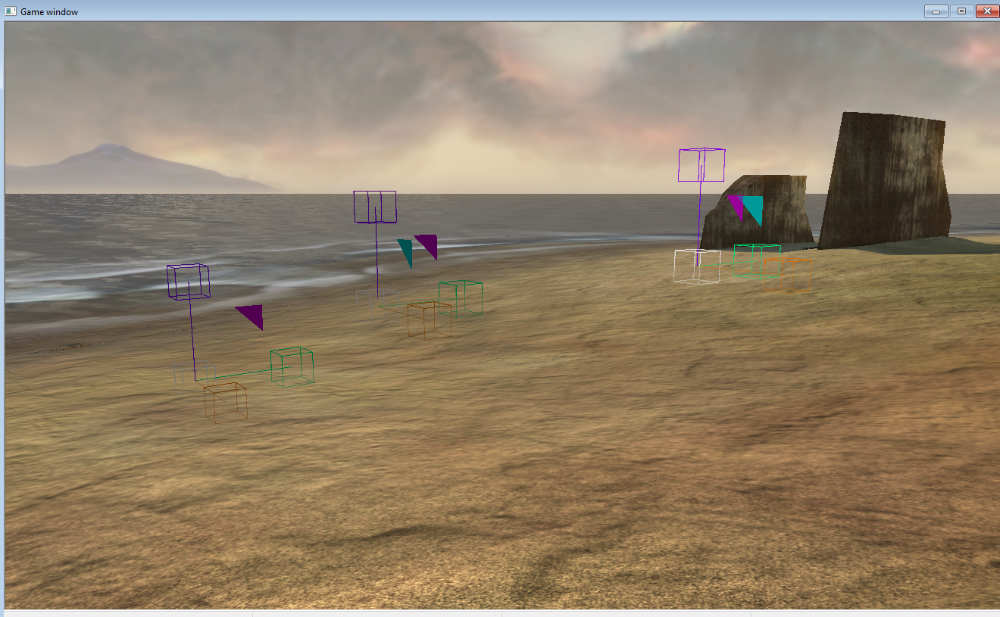
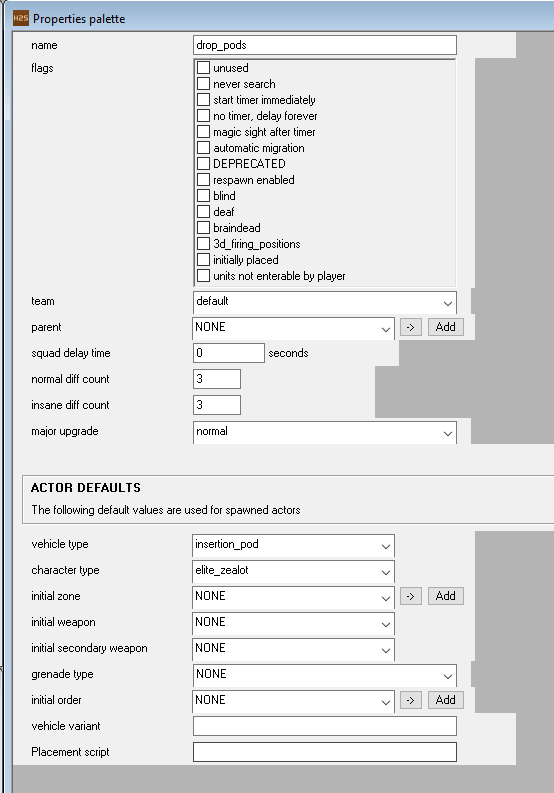
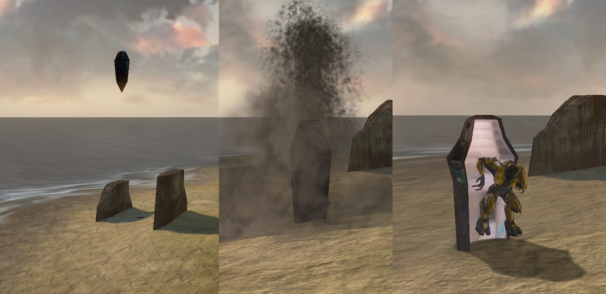

One of the more unique ways of placing enemies is via the insertion pods, more commonly known as drop pods. This guide will detail out how to place, script and prepare for insertion pods in your campaign. This guide focuses only on the Covenant Elite insertion pods, but in theory an HEV ODST pod can be created as well (Retail Halo 2 only had these in cutscenes and never in actual gameplay)

# The approach

Let's start with the practical approach behind these insertion pods. They are vehicles, but are controlled by a customized device_machine tag. The device_machine is invisible and its "on" position is high in the sky, its "off" position is on the ground.
You place these device machines on the places where you want the insertion pods to land. Via scripting, you attach the actual vehicle insertion pod to the device machine. When activating the device machine, the insertion pod moves at high velocity towards the ground and with some effects, the visual of a hard landing is created. The Elite exits the vehicle and combat ensues.

# Sapien

Add the following *device_machine* tags: 

* device_machine: *scenarios\objects\covenant\military\machines\entry_pod_inserter\entry_pod_inserter.device_machine* 
* vehicle: *objects\vehicles\insertion_pod\insertion_pod.vehicle*
* character: *objects\characters\elite\ai\elite.character* 


Place the device_machines on the place where you want the insertion pods to end up.



Next, create a simple squad which has the same amount of actors as device_machines.
Set the vehicle to insertion_pod and the character to Elite.



# Script

The below script is all you need to prep and drop the insertion pod.

A short explanation:
* `pod1` is the name of the device_machine.
* `drop_pods/1` is the squad/actor which contains the vehicle and Elite.
* The device_machine is created via script and set to its aerial position. The Elite + pod is instantiated and attached to the device_machine. They both have a marker called `pod_attach`.
* The device automatically goes to its 0 position. The sleep_until command waits until the device_machine is finished with its drop, and then creates an explosion effect at the landing point.
* The sleep commands are purely there so that, if you have multiple insertion pods, they aren't exactly in sync for a better visual.`
* The door is opened via damaging a specific section of the vehicle
* At the end, the vehicle and device become separated again and and the device is cleaned up.
* Specific effects are located in a scenarios folder: *effects\scenarios\solo\earthcity\e11_insertion_pod_impact* Please ensure your global effect corresponds to an existing location.

Repeat/Expand this script for each of the insertion pods.

```
(global effect pod_effect "scenarios\XXXX\effects\insertion_pod_impact")

(script static void place_pods
	(object_create pod1)

	(device_set_position pod1 1.0)
	(sleep (random_range 10 20)) 
	(ai_place drop_pods/1)
	(objects_attach pod1 "pod_attach" (ai_vehicle_get drop_pods/1) "pod_attach")
	(sleep_until (>= (device_get_position pod1) 1.0) 1)
	(effect_new_on_object_marker pod_effect (ai_vehicle_get drop_pods/1) "pod_attach")

	(sleep (random_range 10 20))
	(object_damage_damage_section (ai_vehicle_get drop_pods/1) "door" 500)

	(sleep (random_range 10 20))
	(ai_vehicle_exit drop_pods/1)

	(sleep (random_range 10 20))

	(objects_detach pod1 (ai_vehicle_get drop_pods/1))
	(object_destroy pod1)
)
```

If all is set up correctly, you can run the script in Sapien successfully and see everything in action.

