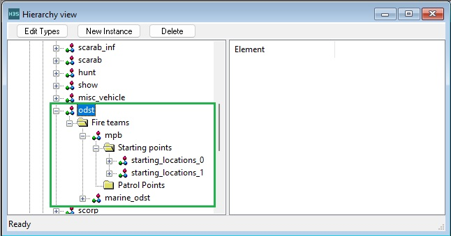
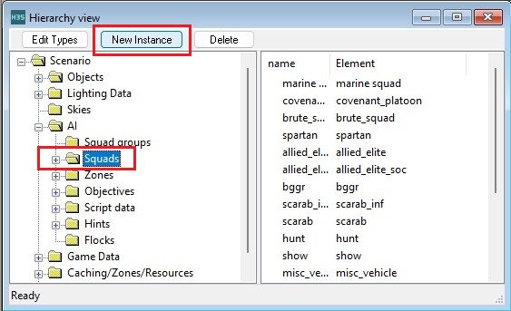
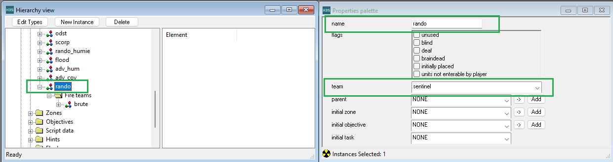
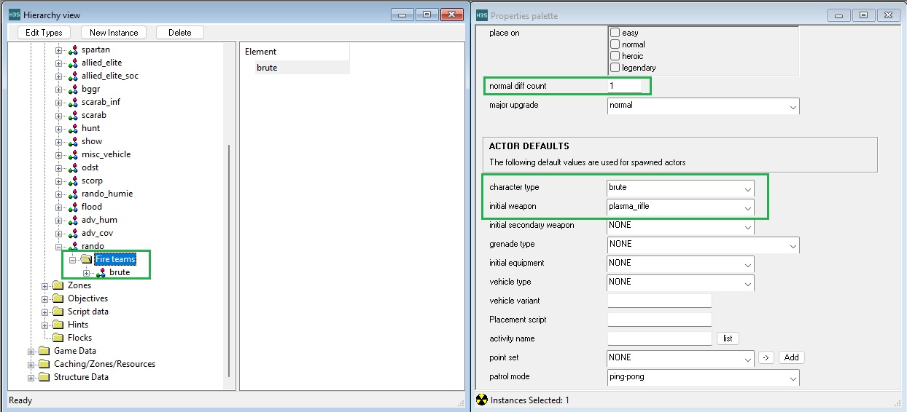
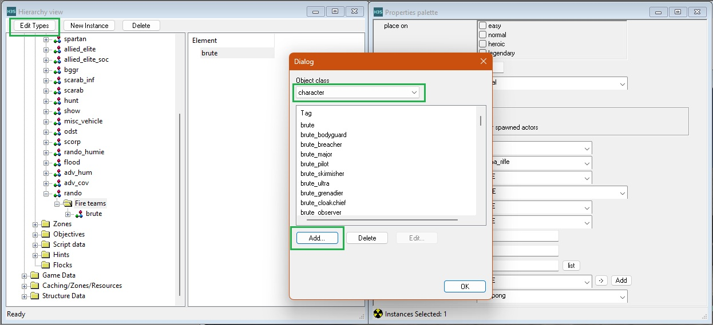
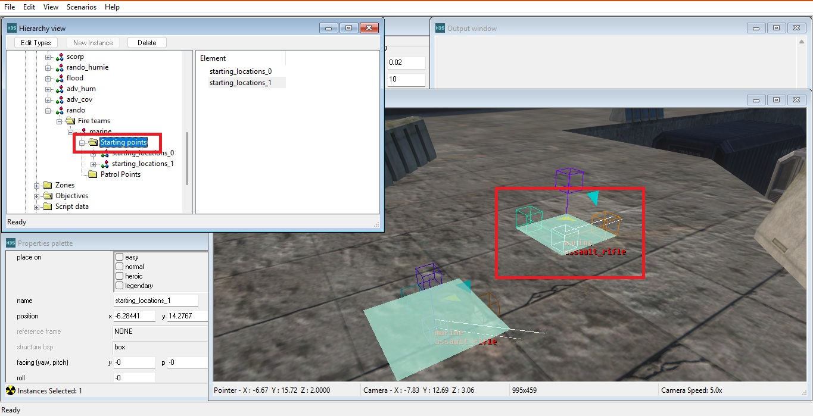
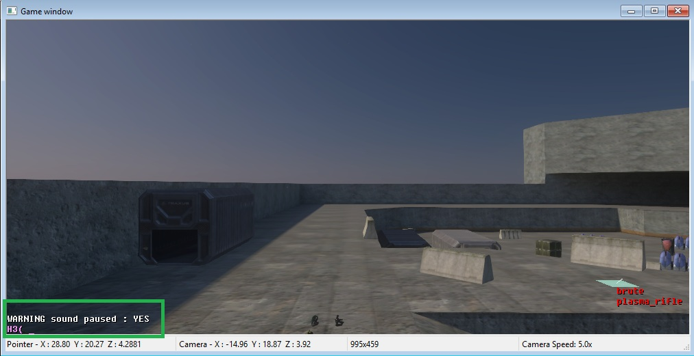
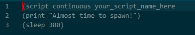
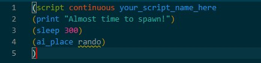
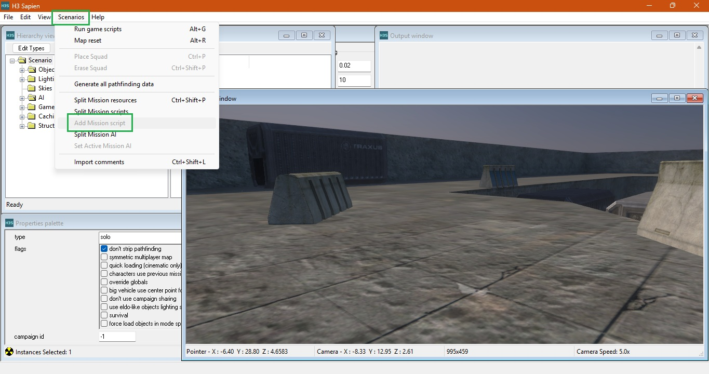

This guide provides general info on how to spawn AI either at-will or via scripts, this guide assumes you have basic understanding of navigating [sapien](~H3-sapien) and the [scripting system](~scripting), as these are essential.

# The Basics
AI in Halo are always part of a squad, even if a single AI is spawned he is still part of a squad, squads can be broken down into fireteams or parented under a `squad group`. Fireteams are then broken down into `starting points` from which the AI will spawn on.

# Squad Creation
Within sapien scroll down to the AI section, click on the squads option and then click `New instance`.

Now you can click your new squad, and in the properties window it's settings will appear, from here you can give the squad a name and set other factors such as default team (default means default to the AI's [biped](~) team).

Now, within your new squad open it up to fireteams and add a new fireteam (remember the button you used to add a new squad, only this time while the fireteam tab is selected), configure this fireteam with whatever AI unit you want and set a `normal diff count` value, this value acts as the number of AI to spawn from this fireteam when the squad is spawned.

You may notice in the properties window there are other traits such as `character type` and `initial weapon`, these are where you define what type of AI to spawn and with what gear they are equiped with, if you have no options for these boxes it means they have not been added to the Scenario. To fix this navigate to the `Edit types` box in Sapien, this will open a window from which you can add new items of different tag types, such as [AI (Characters)](~character) and [weapons](~weapon), simply click the add button and navigate to the specific tag you want and open it.

From here we have one final step, assigning starting `starting points` for the AI to spawn on. Navigate to the `starting point` folder for the fireteam you want to configure, with it selected you can hover to the game window and use **right click** to place a new spawn point, add as many or as few as you want.

# Spawning in Sapien
While the game window is selected (the window the game world appears in), press the  key to open the console, from here you can type various script commands and thread names. For the purposes of scripting AI within Sapien you are going to use the command `ai_place`, you will type this command in **followed by** the name of the squad you created and then press .

# Spawning via Scripting
After opening a text file you can use the [scripting system](~scripting) to set up AI placement without your manual effort, this is how Bungie set up campaign levels and firefight levels in all of their games. Script editors should be encoded for UTF-8.

For a basic script we are going to make a continuously respawning squad script. First we need to declare our script type so we start with `(` to begin our statement, followed up by the term `script` to declare what this function is; a new script thread, and finally we end off with your custom script name, it can be whatever you want but don't include spaces or capitals.

Lets add a debug so we know our script is working, we will use the verb `print` to print a message to the screen in Sapien. Use the term `print` followed up by your message encased in quotation marks, place it on the line below the script declaration.

Now we add statments to perform actions, for this example we will put the AI spawning on a 10 second timer. so we we will use the verb `sleep` followed up by a duration of game ticks (Halo 3 scripting emulates 30 ticks a second) so for 10 seconds we will use the value `300` for a final statement of (sleep 300), `Sleep` pauses the script thread in place for the duration specified.

Finally we spawn the AI using the verb `ai_place` followed up by the name of your squad, then on the line below that add the missing `)` to enclose your entire continuous script thread. Save this file as a .hsc file in your H3EK/data/path-to-your-level/scripts, you can name the script whatever you want.

Then in Sapien to compile this script, first add the script using the `add mission script` button, then use the key combo  to compile this script, if no errors are found you are good to go and all you need to do is use  To Enable/Disable game scripts. After using the `add mission script` button this scenario will now always look for new files in this spot, so you can add new script files whenever you want, or edit the ones already inside, just make sure to compile after any changes.

# What's next
After this you may find that your AI is rather dumb and inactive, this is because they have no purpose or direction. We fix this by adding a [pathfinding setup](~pathfinding) which will build into an [objective setup](~objectives).